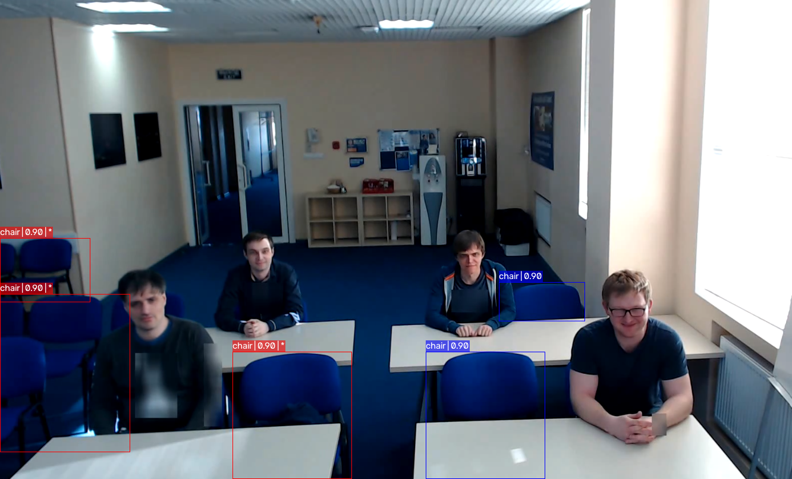
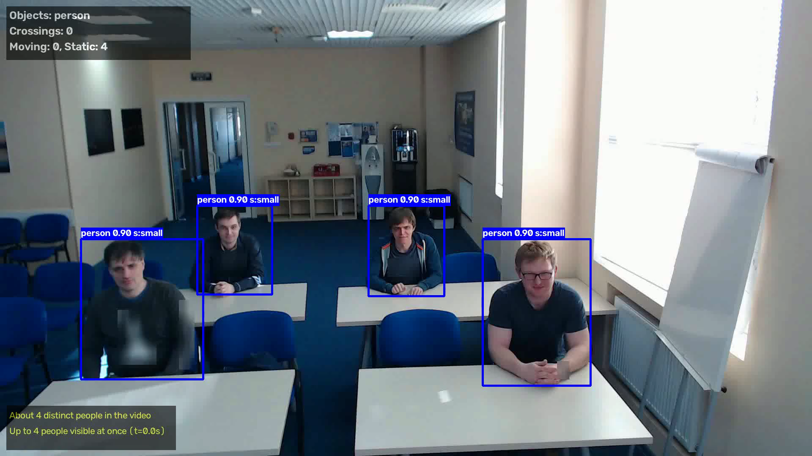
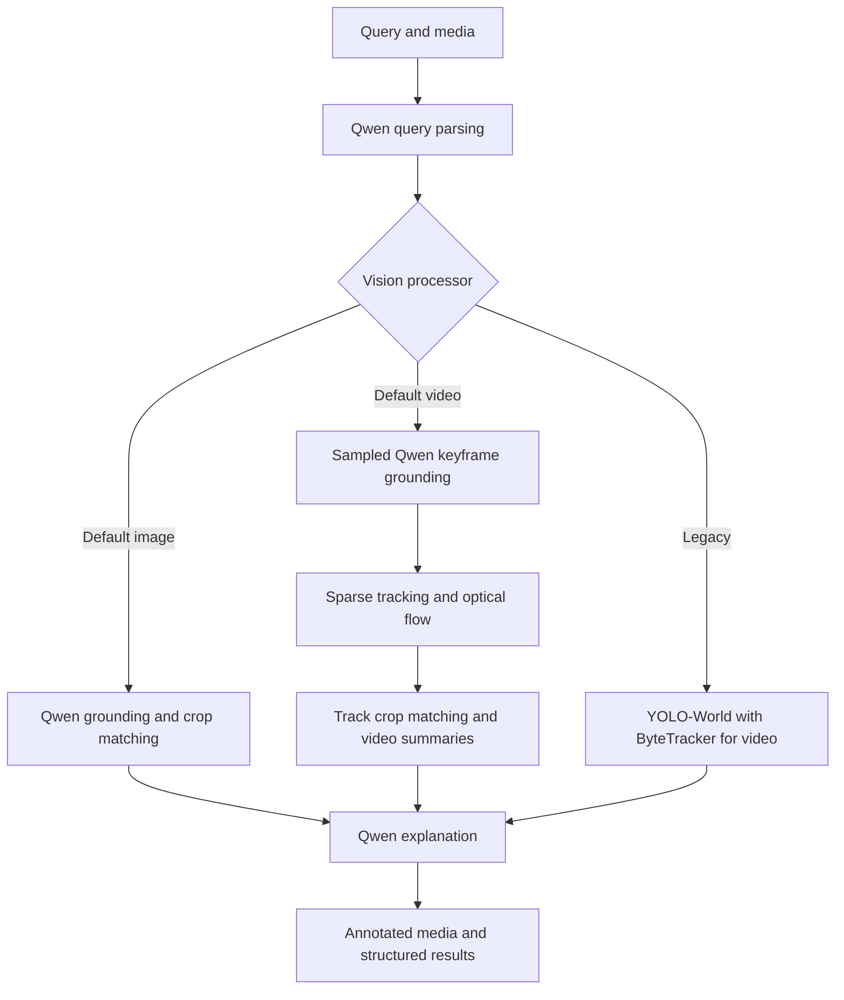

# 🧠 Langvio: Natural Language Computer Vision

<div align="center">


[](https://www.python.org/downloads/)
[](https://opensource.org/licenses/MIT)
[](https://badge.fury.io/py/langvio)
[](https://langvio.readthedocs.io/)

**Connect language models to vision models for natural language visual analysis**

[🚀 Quick Start](#-quick-start) • [📖 Documentation](https://langvio.readthedocs.io/) • [🎯 Examples](#-examples) • [🔧 Installation](#-installation) • [🤝 Contributing](#-contributing)

</div>

---

## ✨ What is Langvio?

Langvio bridges the gap between **human language** and **computer vision**. Ask questions about images and videos in plain English, and get intelligent analysis powered by Qwen-VL — a vision-language model that parses queries, grounds objects, describes scenes, and generates explanations through separate model calls. The current source version is **0.0.8** (Python **3.10–3.12**).

### 🎯 Key Features

- **🗣️ Natural Language Interface**: Ask questions like "Count all red cars" or "Find people wearing yellow"
- **🎥 Multi-Modal Support**: Works with both images and videos
- **🤖 Qwen-VL at the Core**: Qwen-VL powers both grounding (detection) and language (query parsing, explanations), with independently configurable vision and language processors
- **☁️ API by Default, Local Fallback**: Runs over an OpenAI-compatible endpoint (OpenRouter by default) with an API key; falls back to in-process Qwen2.5-VL weights when `langvio[vlm]` is installed and no key is set
- **📦 Legacy YOLO-World Path**: Classic open-vocabulary detection via YOLO-World v2 + ByteTracker still available for users who want it
- **📹 Qwen Video Tracking**: Sparse keyframe grounding, label-aware track association, and CPU optical flow between keyframes; interpolation is the fallback
- **🎯 Attribute Matching**: Descriptive queries such as "the person wearing glasses" select matching objects using detailed crops, including multiple views of video tracks
- **📈 Video Summaries**: Estimated distinct objects, peak simultaneous counts, movement patterns, and centerline crossings
- **📹 Legacy Tracking**: ByteTracker remains available with the YOLO-World path
- **📊 Advanced Analytics**: Object counting, spatial relationships, temporal tracking
- **🎨 Visual Output**: Generates annotated images/videos with detection highlights and tracking trails
- **🌐 Web Interface**: Flask web app included for easy interaction
- **🔧 Extensible**: Easy to add new models and capabilities

## 🎬 See It In Action

### Python API Example

```python
import langvio

# Create a pipeline (uses the hosted Qwen-VL API if OPENROUTER_API_KEY is set,
# otherwise falls back to local Qwen2.5-VL weights)
pipeline = langvio.create_pipeline()

# Analyze an image
result = pipeline.process(
    query="Count how many people are wearing red shirts",
    media_path="street_scene.jpg"
)

print(result['explanation'])
# Output: "I found 3 people wearing red shirts in the image.
#          Two are located in the center-left area, and one is on the right side."

# View the annotated result
print(f"Annotated image saved to: {result['output_path']}")
```

<div align="center">

[](https://www.youtube.com/watch?v=yTYJz2Pr7TE)

</div>

### Command-Line Interface Example

```bash
# Basic usage — prompts for an OpenRouter key on first run, saves it to .env
langvio --query "Count the cars" --media image.jpg

# Pass a key inline (overrides env for this run)
langvio --api-key sk-or-... -q "Find red objects" -m scene.jpg

# Force the local backend (requires `pip install "langvio[vlm]"`)
langvio --backend local -q "What's in this image?" -m photo.jpg
```

<div align="center">

[](https://www.youtube.com/watch?v=f-JnZoHM4to)

</div>

## 🖼️ Latest Example Outputs

Annotated classroom outputs from the current Qwen-VL pipeline.

### Image: Chair Detection



The supplied image shows detected chairs with bounding boxes and labels. Displayed confidence values are assigned by the Qwen processor, rather than calibrated model probabilities.

### Video: Classroom Analysis

[](https://github.com/MugheesMehdi07/langvio/raw/refs/heads/master/assets/classroom_processed.mp4)

[Watch or download the processed video](https://github.com/MugheesMehdi07/langvio/raw/refs/heads/master/assets/classroom_processed.mp4) (32.8 seconds, 1920 × 1080, 30 fps).

Click the video preview or the link to open the MP4. The README uses a clickable preview that links directly to the video file. The file uses H.264 with `yuv420p` and fast-start metadata for browser playback.

## 🔧 Installation

### Basic Installation

```bash
pip install langvio
```

That installs the dependencies for the **hosted API backend** (selected when a key is configured), including the base Torch and Ultralytics dependencies. You only need the local VLM extra if you plan to run Qwen-VL on your own machine.

### Optional: Local VLM Backend

```bash
# Run Qwen2.5-VL in-process via HuggingFace transformers (adds ~several GB on first run)
pip install "langvio[vlm]"

# Equivalent grouped extra
pip install "langvio[all-llm]"

# For development
pip install "langvio[dev]"
```

The first local run downloads Qwen2.5-VL weights from HuggingFace (several GB). A CUDA GPU is strongly recommended; CPU works but is slow.

### Environment Setup

The default (hosted) backend needs an OpenRouter API key. Get one at [openrouter.ai/keys](https://openrouter.ai/keys) and either export it or put it in a `.env` file at your project root — langvio auto-loads `.env` on import.

For a source checkout, copy the supplied template:

```bash
cp .env.template .env
```

For a package-only installation, create `.env` in your working directory.

```env
# Required for the default API backend
OPENROUTER_API_KEY=your_openrouter_api_key_here

# Optional overrides
# QWEN_API_KEY=alternative_key              # alias for OPENROUTER_API_KEY
# QWEN_API_BASE_URL=https://openrouter.ai/api/v1
# QWEN_API_MODEL=qwen/qwen3-vl-30b-a3b-instruct
# LANGVIO_BACKEND=auto                      # auto | api | local
# LANGVIO_DEFAULT_LLM=qwen
# LANGVIO_DEFAULT_VISION=qwen_vlm

# Optional (local backend only)
# HF_HOME=/path/to/hf-cache
# HF_TOKEN=your_huggingface_token_here      # for gated models
```

If no key is set and you run the CLI interactively, langvio will **prompt you for one** and save a supplied key to `.env` in the current directory. Press Enter to leave the key unset. In `auto` mode this selects local weights and requires the `vlm` extra. An API request failure does not automatically switch to local inference. Noninteractive runs do not prompt.

## 🚀 Quick Start

### Basic Usage

```python
import langvio

# Pipeline auto-resolves the backend: API if a key is configured, else local.
pipeline = langvio.create_pipeline()

# Process an image
result = pipeline.process(
    query="What objects are in this image?",
    media_path="path/to/your/image.jpg"
)

print(result['explanation'])
print(f"Output: {result['output_path']}")
```

### Video Analysis

```python
# Analyze videos with temporal understanding
result = pipeline.process(
    query="Count vehicles crossing the intersection",
    media_path="traffic_video.mp4"
)

print(result['explanation'])
```

### Web Interface

The Flask app is run from a source checkout; the package build excludes `webapp/`.

```bash
git clone https://github.com/MugheesMehdi07/langvio.git
cd langvio
pip install -e ".[webapp]"
cp .env.template .env
# Set OPENROUTER_API_KEY in .env, then:
cd webapp
python run_server.py
```

Open [http://localhost:5001](http://localhost:5001). The launcher disables debug mode and the reloader. The UI accepts PNG/JPG/JPEG images and MP4/MOV/AVI/WebM videos up to 100 MB, displays explanations and summary statistics, and provides annotated results. Video playback uses the FFmpeg binary bundled with `imageio-ffmpeg` for browser-compatible encoding. For local inference, install `".[webapp,vlm]"` instead.

## 🎯 Examples

### Object Detection & Counting

```python
# Count specific objects
pipeline.process("How many cars are in this parking lot?", "parking.jpg")

# Find objects by attributes
pipeline.process("Find all red objects in this image", "scene.jpg")

# Spatial relationships
pipeline.process("What objects are on the table?", "kitchen.jpg")
```

### Qwen-VL Video Tracking and Attribute Queries

The default Qwen path grounds sampled keyframes and links objects across time. Optical flow follows boxes between keyframes on the CPU, with interpolation as a fallback. Descriptive queries verify candidate tracks using clear crops from multiple moments, helping keep the selected identity consistent.

```python
pipeline = langvio.create_pipeline()
result = pipeline.process("Track the person wearing glasses", "crowd.mp4")

summary = result["detections"]["summary"]
counts = summary["counting_analysis"]
print(counts["estimated_objects"])
print(counts["max_simultaneous"])
print(summary.get("query_match", {}))
```

The distinct-object estimate is the larger of the confirmed-track count and the peak simultaneous count for each label. `unique_objects` also includes tracks seen only once, so it can overcount re-detections. Centerline crossings use the vertical midpoint with a dead zone; entry/exit statistics are inferred from first and last track observations. These are estimates from sampled frames. Motion categories use image-relative displacement, rather than calibrated physical speed.

For the legacy YOLO-World + ByteTracker path, configure the detector at pipeline creation:

```python
legacy_pipeline = langvio.create_pipeline(vision_name="yolo_world_v2_m")
result = legacy_pipeline.process("Track vehicles through the scene", "traffic.mp4")
```

`process()` accepts only `query` and `media_path`. To change processors later, use `pipeline.set_vision_processor(name)` or `pipeline.set_llm_processor(name)`.

### Advanced Queries

```python
# Complex multi-part analysis
pipeline.process(
    "Count people and vehicles, identify their locations, and note distinctive colors",
    "street_scene.jpg"
)

# Verification tasks
pipeline.process("Is there a dog in this image?", "park_scene.jpg")
```

## 🏗️ Architecture



Language and vision processors resolve their backend independently. Hosted mode sends images/crops to an OpenAI-compatible API; local mode uses HuggingFace weights. Matching local model IDs share cached weights. Query parsing, grounding, optional scene descriptions, crop matching, and explanation generation can each involve separate calls.

### Core Components

- **Qwen-VL language processor** (`langvio/llm/qwen_vlm.py`): Parses natural-language queries into targets, attributes, and task parameters, then explains the structured detection results.
- **Qwen-VL vision processor** (`langvio/vision/qwen_vlm/detector.py`): Grounds objects in images and sampled video keyframes, normalizes bounding boxes, filters duplicate/repetitive detections, and optionally describes the scene.
- **Qwen video tracking** (`tracking.py`, `propagation.py`): Associates keyframe detections using labels, box overlap, and predicted motion; propagates boxes with CPU optical flow or falls back to interpolation.
- **Qwen attribute matching** (`matching.py`): Checks detailed object crops against descriptive queries; video matching uses selected views from each candidate track.
- **Qwen summaries** (`summary.py`): Builds image distributions and video counting/movement statistics for explanations, overlays, and the web UI.
- **Hosted/local backend** (`qwen_api.py`, `qwen_loader.py`): Uses an OpenAI-compatible API for hosted Qwen models or loads Qwen2.5-VL / Qwen2-VL locally. Matching local model IDs share cached weights.
- **Pipeline and media visualization**: Coordinate parsing, detection, explanation, and annotated output. YOLO-World + ByteTracker remains a legacy vision option.

## 📊 Supported Models

### Language / Vision Models (Qwen-VL)

Vision aliases are `qwen_vlm` / `qwen_vlm_3b` / `qwen_vlm_7b`. Their configured hosted defaults are respectively `qwen/qwen3-vl-30b-a3b-instruct`, `qwen/qwen3-vl-8b-instruct`, and `qwen/qwen3-vl-235b-a22b-instruct`. Language aliases and vision aliases are selected separately; choosing `llm_name="qwen-7b"` does not change the vision model.

**Hosted API** (default — needs `OPENROUTER_API_KEY`, configured per processor in YAML; see configuration precedence below):

- `qwen/qwen3-vl-30b-a3b-instruct` — **default hosted model**
- `qwen/qwen3-vl-8b-instruct` — configured hosted model for `qwen_vlm_3b` and `qwen-3b`
- `qwen/qwen3-vl-235b-a22b-instruct` — configured hosted model for `qwen_vlm_7b`
- `qwen/qwen2.5-vl-72b-instruct` — pixel-space bounding boxes

The client supports OpenAI-compatible chat-completions endpoints with image input (OpenRouter, Alibaba Model Studio / DashScope, HuggingFace router, self-hosted vLLM) — set `QWEN_API_BASE_URL`.

**Local backend** (needs `pip install "langvio[vlm]"`, model loaded in-process via HuggingFace):

- `qwen` / `qwen-3b` — `Qwen/Qwen2.5-VL-3B-Instruct` (3B local model)
- `qwen-7b` — `Qwen/Qwen2.5-VL-7B-Instruct` (7B local model)
- `qwen2-vl-7b` — `Qwen/Qwen2-VL-7B-Instruct`

### Legacy Vision Models (YOLO-World v2)

Available by name when you want classic detection + ByteTracker instead of Qwen-VL grounding:

- `yolo_world_v2_s` — Small (fastest)
- `yolo_world_v2_m` — Medium (balanced)
- `yolo_world_v2_l` — Large (most accurate)
- `yolo_world_v2x` — Extra-large

Aliases: `yolo11n`, `yolo`, `yoloe` → small; `yoloe_medium` → medium; `yoloe_large` → large.

## 🛠️ Configuration

### Custom Configuration

Custom YAML merges recursively with [the shipped defaults](langvio/default_config.yaml). Set API options in both the language and vision entries when changing both layers. Processor-level `api_model` and `api_base_url` take precedence over `QWEN_API_MODEL` / `QWEN_API_BASE_URL`; the shipped Qwen entries already set `api_model`, so use YAML to reliably override model selection. The CLI maps `--api-model` to that environment variable and therefore has the same limitation. `LANGVIO_BACKEND` takes precedence over each processor's `backend` setting.

```yaml
# config.yaml
llm:
  default: "qwen"
  models:
    qwen:
      # Qwen-VL — same name for both backends; `backend` + `api_model` decide
      # which path is used.
      model_name: "Qwen/Qwen2.5-VL-3B-Instruct"   # used by local backend
      backend: "auto"                              # auto | api | local
      api_key_env: "OPENROUTER_API_KEY"
      api_model: "qwen/qwen3-vl-30b-a3b-instruct"  # used by API backend
      api_base_url: "https://openrouter.ai/api/v1"
      model_kwargs:
        temperature: 0.2
        max_new_tokens: 1024

vision:
  default: "qwen_vlm"
  models:
    qwen_vlm:
      model_name: "Qwen/Qwen2.5-VL-3B-Instruct"
      api_model: "qwen/qwen3-vl-30b-a3b-instruct"
      api_base_url: "https://openrouter.ai/api/v1"
      max_image_size: 1024
      max_video_frames: 24
      keyframes_per_second: 1.0
      api_concurrency: 4
      optical_flow: true
      flow_size: 640
      auto_vocabulary: true
      repetition_min_run: 5
      match_views: 2
      match_batch_size: 12
      scene_description: true
      scene_frames: 4
    # Legacy detector:
    yolo_world_v2_m:
      type: "yolo_world"
      model_name: "yolov8m-worldv2"
      confidence: 0.45
      # ByteTracker configuration
      track_thresh: 0.3      # Detection confidence threshold for tracking
      track_buffer: 70       # Frames to keep lost tracks
      match_thresh: 0.6      # IoU threshold for track matching

media:
  output_dir: "./results"
  visualization:
    box_color: [0, 255, 0]
    line_thickness: 2
```

```python
# Use custom configuration
pipeline = langvio.create_pipeline(config_path="config.yaml")
```

### Command Line Interface

```bash
# Basic usage (prompts for key if none set; falls back to local on empty input)
langvio --query "Count the cars" --media image.jpg

# All CLI flags
langvio \
  --query "Find red objects" \
  --media scene.jpg \
  --config custom.yaml \
  --api-key sk-or-...                       \
  --api-model qwen/qwen3-vl-8b-instruct     \
  --api-base-url https://openrouter.ai/api/v1 \
  --backend auto                            \
  --vision qwen_vlm                         \
  --llm qwen                                \
  --output ./results

# List available models
langvio --list-models
```

### Qwen Model Selection

Select both processors when changing the complete Qwen pipeline:

```python
# Default: hosted Qwen3-VL when a key is set; local Qwen2.5-VL otherwise.
pipeline = langvio.create_pipeline(llm_name="qwen", vision_name="qwen_vlm")

# Use the 7B local model for both stages when LANGVIO_BACKEND=local.
# In API mode these aliases use their separately configured hosted models.
pipeline_7b = langvio.create_pipeline(
    llm_name="qwen-7b", vision_name="qwen_vlm_7b"
)
```

Hosted Qwen inference avoids local model-weight downloads. Local Qwen inference requires the `vlm` extra and sufficient memory for the selected weights. Adjust keyframe density, image size, and API concurrency using the Qwen settings below.

## 📦 Results and Output

`pipeline.process(query, media_path)` returns:

| Field | Contents |
| --- | --- |
| `query`, `media_path`, `media_type` | Original request and detected media type |
| `explanation` | Generated natural-language analysis |
| `output_path` | Annotated image or video path |
| `detections` | Structured objects, summaries, and processor metadata |
| `query_params` | Parsed targets, task, and attributes |
| `highlighted_objects` | Objects selected for emphasis |

Qwen image detections contain `objects` and `summary`. Video detections contain `frame_detections` (sampled keyframes), `render_detections` (boxes for rendering), `tracks`, `summary`, `processing_info`, and `metadata`. Use `processing_info` to inspect analyzed/failed frame counts, the selected model, and processing time. The CLI's printed detection totals count observations and should not be interpreted as distinct video objects; use `summary.counting_analysis` for video counts.

Annotated media defaults to `./output`. Detection logs are written to `logs/detections_<media>_<timestamp>.json`; dense `render_detections` are omitted from those logs. Logging defaults to `langvio.log`.

## ⚡ Qwen-VL Video Tuning and Limits

| Qwen vision setting | Default | Purpose |
| --- | --- | --- |
| `max_video_frames` | 24 | Keyframe budget; a final endpoint frame may be added |
| `keyframes_per_second` | 1.0 | Target sampling density, reduced for longer clips to fit the budget |
| `max_image_size` | 1024 | Longest image side sent for grounding |
| `api_concurrency` | 4 | Parallel hosted keyframe requests |
| `optical_flow` / `flow_size` | `true` / 640 | CPU propagation between keyframes |
| `auto_vocabulary` | `true` | Discover shared labels when the query names no objects |
| `repetition_min_run` | 5 | Filter repetitive box runs; 0 disables the filter |
| `match_views` / `match_batch_size` | 2 / 12 | Views per candidate track and candidates per matching call |
| `scene_description` / `scene_frames` | `true` / 4 | Scene context for explanations |

More keyframes and larger images can improve detail at the cost of latency and hosted requests. Attribute matching and vocabulary discovery add calls. The API client retries transient failures and coordinates rate-limit cooldowns across concurrent requests. Failed video keyframes are reported; if every keyframe fails, processing raises an error.

Boxes between grounded keyframes are propagated or interpolated, rather than independently detected. Fast motion, occlusion, crowded scenes, and very brief appearances can still fragment tracks or miss objects. The Qwen `confidence` value (default 0.9) is assigned to boxes, not a calibrated model probability. Movement/activity labels are summary heuristics, not a dedicated action-recognition model.

The CLI recognizes JPG/JPEG/PNG/BMP/TIFF/WebP images and MP4/AVI/MOV/MKV/WebM videos; actual decoding depends on the installed imaging/video libraries. The web interface has the narrower upload list described above.

## 🧪 Testing

```bash
# Install test dependencies
pip install "langvio[dev]"

# Run all tests
pytest

# Run with coverage
pytest --cov=langvio --cov-report=html

# Run specific test file
pytest tests/test_config.py
```

See [tests/README.md](tests/README.md) for more testing information.

## 🤝 Contributing

### Development Setup

```bash
# Clone the repository
git clone https://github.com/MugheesMehdi07/langvio.git
cd langvio

# Install in development mode
pip install -e ".[dev]"

# Run tests
pytest

# Format code
black langvio/
isort langvio/
```

### Contributing Guidelines

1. **Fork** the repository
2. **Create** a feature branch (`git checkout -b feature/amazing-feature`)
3. **Commit** your changes (`git commit -m 'Add amazing feature'`)
4. **Push** to the branch (`git push origin feature/amazing-feature`)
5. **Open** a Pull Request

## 📚 Documentation

- **📖 [Full Documentation](https://langvio.readthedocs.io/)**: Comprehensive guides and API reference
- **🎯 [Examples](./examples/)**: Ready-to-run example scripts
- **🌐 [Web App](./webapp/)**: Flask web interface for easy testing
- **⚙️ [Configuration](./examples/config_examples/)**: Sample configuration files

## 🔗 Links & Resources

- **🐙 [GitHub Repository](https://github.com/MugheesMehdi07/langvio)**
- **📦 [PyPI Package](https://pypi.org/project/langvio/)**
- **📖 [Documentation](https://langvio.readthedocs.io/)**
- **🐛 [Issue Tracker](https://github.com/MugheesMehdi07/langvio/issues)**

## 📄 MIT License

Copyright (c) 2026 LangVio

Permission is hereby granted, free of charge, to any person obtaining a copy
of this software and associated documentation files (the "Software"), to deal
in the Software without restriction, including without limitation the rights
to use, copy, modify, merge, publish, distribute, sublicense, and/or sell
copies of the Software, and to permit persons to whom the Software is
furnished to do so, subject to the following conditions:

The above copyright notice and this permission notice shall be included in all
copies or substantial portions of the Software.

THE SOFTWARE IS PROVIDED "AS IS", WITHOUT WARRANTY OF ANY KIND, EXPRESS OR
IMPLIED, INCLUDING BUT NOT LIMITED TO THE WARRANTIES OF MERCHANTABILITY,
FITNESS FOR A PARTICULAR PURPOSE AND NONINFRINGEMENT. IN NO EVENT SHALL THE
AUTHORS OR COPYRIGHT HOLDERS BE LIABLE FOR ANY CLAIM, DAMAGES OR OTHER
LIABILITY, WHETHER IN AN ACTION OF CONTRACT, TORT OR OTHERWISE, ARISING FROM,
OUT OF OR IN CONNECTION WITH THE SOFTWARE OR THE USE OR OTHER DEALINGS IN THE
SOFTWARE.

### Usage and License Notices

This project uses certain datasets, models, APIs, and algorithms that are subject to their respective original licenses and terms of use. Users must comply with all terms and conditions of these original licenses, including but not limited to:

- **Qwen (Tongyi Qianwen) License**: This project uses Alibaba Cloud's Qwen-VL family (Qwen3-VL via OpenAI-compatible APIs, and/or Qwen2.5-VL / Qwen2-VL run locally via HuggingFace transformers). Users must comply with the [Qwen license terms](https://github.com/QwenLM/Qwen2.5-VL/blob/main/LICENSE) published on the respective model cards.

- **YOLO-World License**: The optional YOLO-World v2 detectors are developed by Ultralytics. Users must comply with the [Ultralytics YOLO License](https://github.com/ultralytics/ultralytics/blob/main/LICENSE) (AGPL-3.0) and any additional terms specified by Ultralytics for YOLO-World.

- **ByteTracker License**: The ByteTracker algorithm used for multi-object tracking is subject to its original license — see the [ByteTracker repository](https://github.com/ifzhang/ByteTrack).

- **OpenRouter / API Providers**: When using the hosted API backend, usage is also governed by the terms of the chosen provider (OpenRouter, Alibaba Model Studio, etc.).

This project does not impose any additional constraints beyond those stipulated in the original licenses. Users are responsible for ensuring that their use of the datasets, models, APIs, and algorithms is in compliance with all applicable laws and regulations.

For the full project license text, see [LICENSE](LICENSE).

## 🙏 Acknowledgments

- **Alibaba Cloud / Qwen** for the Qwen-VL vision-language models
- **OpenRouter** and the broader OpenAI-compatible API ecosystem that makes the hosted backend portable
- **HuggingFace** for `transformers` and model hosting
- **Ultralytics** for YOLO-World v2 (optional legacy path)
- **ByteTracker** for robust multi-object tracking
- **LangChain** for the LLM integration framework
- **OpenCV** for computer vision utilities

---

<div align="center">

**⭐ Star us on GitHub if Langvio helps you!**

[⭐ Star](https://github.com/MugheesMehdi07/langvio) • [🔗 Share](https://twitter.com/intent/tweet?text=Check%20out%20Langvio%20-%20Natural%20Language%20Computer%20Vision!&url=https://github.com/MugheesMehdi07/langvio) • [🐛 Report Bug](https://github.com/MugheesMehdi07/langvio/issues)

</div>
