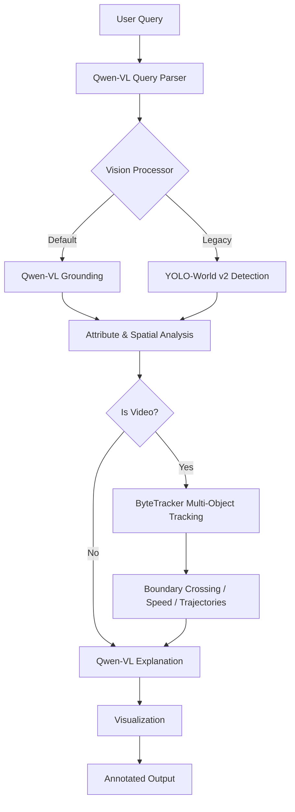

# 🧠 Langvio: Natural Language Computer Vision

<div align="center">


[](https://www.python.org/downloads/)
[](https://opensource.org/licenses/MIT)
[](https://badge.fury.io/py/langvio)
[](https://langvio.readthedocs.io/)

**Connect language models to vision models for natural language visual analysis**

[🚀 Quick Start](#-quick-start) • [📖 Documentation](https://langvio.readthedocs.io/) • [🎯 Examples](#-examples) • [🔧 Installation](#-installation) • [🤝 Contributing](#-contributing)

</div>

---

## ✨ What is Langvio?

Langvio bridges the gap between **human language** and **computer vision**. Ask questions about images and videos in plain English, and get intelligent analysis powered by Qwen-VL — a vision-language model that grounds objects and generates explanations in a single pass.

### 🎯 Key Features

- **🗣️ Natural Language Interface**: Ask questions like "Count all red cars" or "Find people wearing yellow"
- **🎥 Multi-Modal Support**: Works with both images and videos
- **🤖 Qwen-VL at the Core**: Qwen-VL does both grounding (detection) and language (query parsing, explanations) — one model, one coherent pipeline
- **☁️ API by Default, Local Fallback**: Runs over an OpenAI-compatible endpoint (OpenRouter by default) with an API key; falls back to in-process Qwen2.5-VL weights when `langvio[vlm]` is installed and no key is set
- **📦 Legacy YOLO-World Path**: Classic open-vocabulary detection via YOLO-World v2 + ByteTracker still available for users who want it
- **📹 Multi-Object Tracking**: ByteTracker integration for video analysis with boundary crossing and speed estimation
- **📊 Advanced Analytics**: Object counting, spatial relationships, temporal tracking
- **🎨 Visual Output**: Generates annotated images/videos with detection highlights and tracking trails
- **🌐 Web Interface**: Flask web app included for easy interaction
- **🔧 Extensible**: Easy to add new models and capabilities

## 🎬 See It In Action

### Python API Example

```python
import langvio

# Create a pipeline (uses the hosted Qwen-VL API if OPENROUTER_API_KEY is set,
# otherwise falls back to local Qwen2.5-VL weights)
pipeline = langvio.create_pipeline()

# Analyze an image
result = pipeline.process(
    query="Count how many people are wearing red shirts",
    media_path="street_scene.jpg"
)

print(result['explanation'])
# Output: "I found 3 people wearing red shirts in the image.
#          Two are located in the center-left area, and one is on the right side."

# View the annotated result
print(f"Annotated image saved to: {result['output_path']}")
```

<div align="center">

[](https://www.youtube.com/watch?v=yTYJz2Pr7TE)

</div>

### Command-Line Interface Example

```bash
# Basic usage — prompts for an OpenRouter key on first run, saves it to .env
langvio --query "Count the cars" --media image.jpg

# Pass a key inline (overrides env for this run)
langvio --api-key sk-or-... -q "Find red objects" -m scene.jpg

# Force the local backend (requires `pip install langvio[vlm]`)
langvio --backend local -q "What's in this image?" -m photo.jpg
```

<div align="center">

[](https://www.youtube.com/watch?v=f-JnZoHM4to)

</div>

## 🖼️ Example Output

A chair-detection run on a classroom video. The still is one annotated frame; click it to play the full MP4.

<div align="center">

<a href="https://github.com/MugheesMehdi07/langvio/raw/master/assets/classroom_processed.mp4">
  
</a>

<br/>
<em>Query: "detect all chairs in the room" • Click the frame to play the processed video.</em>

</div>

## 🔧 Installation

### Basic Installation

```bash
pip install langvio
```

That's enough to use the **hosted API backend** (default). You only need the local VLM extra if you plan to run Qwen-VL on your own machine.

### Optional: Local VLM Backend

```bash
# Run Qwen2.5-VL in-process via HuggingFace transformers (adds ~several GB on first run)
pip install langvio[vlm]

# Equivalent grouped extra
pip install langvio[all-llm]

# For development
pip install langvio[dev]
```

The first local run downloads Qwen2.5-VL weights from HuggingFace (several GB). A CUDA GPU is strongly recommended; CPU works but is slow.

### Environment Setup

The default (hosted) backend needs an OpenRouter API key. Get one at [openrouter.ai/keys](https://openrouter.ai/keys) and either export it or put it in a `.env` file at your project root — langvio auto-loads `.env` on import.

```bash
cp .env.template .env
```

```env
# Required for the default API backend
OPENROUTER_API_KEY=your_openrouter_api_key_here

# Optional overrides
# QWEN_API_KEY=alternative_key              # alias for OPENROUTER_API_KEY
# QWEN_API_BASE_URL=https://openrouter.ai/api/v1
# QWEN_API_MODEL=qwen/qwen3-vl-30b-a3b-instruct
# LANGVIO_BACKEND=auto                      # auto | api | local
# LANGVIO_DEFAULT_LLM=qwen
# LANGVIO_DEFAULT_VISION=qwen_vlm

# Optional (local backend only)
# HF_HOME=/path/to/hf-cache
# HF_TOKEN=your_huggingface_token_here      # for gated models
```

If no key is set and you run the CLI interactively, langvio will **prompt you for one** and offer to save it to `.env`. Press Enter at the prompt to fall back to the local backend instead.

## 🚀 Quick Start

### Basic Usage

```python
import langvio

# Pipeline auto-resolves the backend: API if a key is configured, else local.
pipeline = langvio.create_pipeline()

# Process an image
result = pipeline.process(
    query="What objects are in this image?",
    media_path="path/to/your/image.jpg"
)

print(result['explanation'])
print(f"Output: {result['output_path']}")
```

### Video Analysis

```python
# Analyze videos with temporal understanding
result = pipeline.process(
    query="Count vehicles crossing the intersection",
    media_path="traffic_video.mp4"
)

print(result['explanation'])
```

### Web Interface

```bash
# Launch the web interface
cd webapp
python app.py

# Visit http://localhost:5000 in your browser
```

## 🎯 Examples

### Object Detection & Counting

```python
# Count specific objects
pipeline.process("How many cars are in this parking lot?", "parking.jpg")

# Find objects by attributes
pipeline.process("Find all red objects in this image", "scene.jpg")

# Spatial relationships
pipeline.process("What objects are on the table?", "kitchen.jpg")
```

### Video Analysis with ByteTracker

ByteTracker is wired into the legacy YOLO-World path for multi-object tracking across frames:

```python
# Track movement patterns
pipeline.process("Track people walking through the scene", "crowd.mp4",
                 vision_name="yolo_world_v2_m")

# Boundary crossing (entry/exit counts)
pipeline.process("How many vehicles entered vs exited the intersection?",
                 "traffic.mp4", vision_name="yolo_world_v2_m")

# Speed analysis via tracked trajectories
pipeline.process("What's the average speed of vehicles?", "highway.mp4",
                 vision_name="yolo_world_v2_m")
```

### Advanced Queries

```python
# Complex multi-part analysis
pipeline.process(
    "Count people and vehicles, identify their locations, and note distinctive colors",
    "street_scene.jpg"
)

# Verification tasks
pipeline.process("Is there a dog in this image?", "park_scene.jpg")
```

## 🏗️ Architecture



### Core Components

- **🧠 Qwen-VL Processor**: Parses queries, grounds objects, and generates explanations. Runs over the OpenRouter API by default; locally via HuggingFace transformers with `langvio[vlm]`.
- **👁️ YOLO-World v2 Processor (optional)**: Legacy open-vocabulary detector for use cases where YOLO-level latency and class-flexible detection are preferred.
- **📹 ByteTracker**: Multi-object tracker used with the YOLO-World path for videos — boundary crossing, counting, speed estimation.
- **🎨 Media Processor**: Creates visualizations and handles I/O.
- **⚙️ Pipeline**: Orchestrates the entire workflow and resolves the backend (`api` / `local` / `auto`).

## 📊 Supported Models

### Language / Vision Models (Qwen-VL)

**Hosted API** (default — needs `OPENROUTER_API_KEY`, selected via `--api-model` or `QWEN_API_MODEL`):

- `qwen/qwen3-vl-30b-a3b-instruct` — **default**, sparse MoE, strong grounding at small-model cost
- `qwen/qwen3-vl-8b-instruct` — cheaper, lower latency
- `qwen/qwen3-vl-235b-a22b-instruct` — highest quality
- `qwen/qwen2.5-vl-72b-instruct` — pixel-space bounding boxes

Any OpenAI-compatible endpoint works (OpenRouter, Alibaba Model Studio / DashScope, HuggingFace router, self-hosted vLLM) — set `QWEN_API_BASE_URL`.

**Local backend** (needs `pip install langvio[vlm]`, model loaded in-process via HuggingFace):

- `qwen` / `qwen-3b` — `Qwen/Qwen2.5-VL-3B-Instruct` (smallest, fastest)
- `qwen-7b` — `Qwen/Qwen2.5-VL-7B-Instruct` (higher quality)
- `qwen2-vl-7b` — `Qwen/Qwen2-VL-7B-Instruct`

### Legacy Vision Models (YOLO-World v2)

Available by name when you want classic detection + ByteTracker instead of Qwen-VL grounding:

- `yolo_world_v2_s` — Small (fastest)
- `yolo_world_v2_m` — Medium (balanced)
- `yolo_world_v2_l` — Large (most accurate)
- `yolo_world_v2x` — Extra-large

Aliases: `yolo11n`, `yolo`, `yoloe` → small; `yoloe_medium` → medium; `yoloe_large` → large.

## 🛠️ Configuration

### Custom Configuration

```yaml
# config.yaml
llm:
  default: "qwen"
  models:
    qwen:
      # Qwen-VL — same name for both backends; `backend` + `api_model` decide
      # which path is used.
      model_name: "Qwen/Qwen2.5-VL-3B-Instruct"   # used by local backend
      backend: "auto"                              # auto | api | local
      api_key_env: "OPENROUTER_API_KEY"
      api_model: "qwen/qwen3-vl-30b-a3b-instruct"  # used by API backend
      api_base_url: "https://openrouter.ai/api/v1"
      model_kwargs:
        temperature: 0.2
        max_new_tokens: 1024

vision:
  default: "qwen_vlm"
  models:
    qwen_vlm:
      model_name: "Qwen/Qwen2.5-VL-3B-Instruct"
    # Legacy detector:
    yolo_world_v2_m:
      type: "yolo_world"
      model_name: "yolov8m-worldv2"
      confidence: 0.45
      # ByteTracker configuration
      track_thresh: 0.3      # Detection confidence threshold for tracking
      track_buffer: 70       # Frames to keep lost tracks
      match_thresh: 0.6      # IoU threshold for track matching

media:
  output_dir: "./results"
  visualization:
    box_color: [0, 255, 0]
    line_thickness: 2
```

```python
# Use custom configuration
pipeline = langvio.create_pipeline(config_path="config.yaml")
```

### Command Line Interface

```bash
# Basic usage (prompts for key if none set; falls back to local on empty input)
langvio --query "Count the cars" --media image.jpg

# All CLI flags
langvio \
  --query "Find red objects" \
  --media scene.jpg \
  --config custom.yaml \
  --api-key sk-or-...                       \
  --api-model qwen/qwen3-vl-8b-instruct     \
  --api-base-url https://openrouter.ai/api/v1 \
  --backend auto                            \
  --vision qwen_vlm                         \
  --llm qwen                                \
  --output ./results

# List available models
langvio --list-models
```

## 🌟 Advanced Features

### Video Tracking with ByteTracker

Used with the YOLO-World path for robust multi-object tracking across frames.

- **Multi-Object Tracking**: Persistent IDs across frames
- **Boundary Crossing Detection**: Entry/exit counts for defined regions
- **Speed Estimation**: Trajectory-based speed per track
- **Track Persistence**: Survives short occlusions via configurable buffer
- **Configurable Thresholds**: `track_thresh`, `track_buffer`, `match_thresh`

Technical:

- Kalman filter-based motion prediction
- IoU-based data association
- High/low-confidence detection handling
- Automatic track initialization and termination

### Spatial Relationship Analysis

- **Positional Understanding**: "objects on the table", "cars in the parking lot"
- **Relative Positioning**: left/right, above/below, near/far
- **Containment Detection**: objects inside other objects

### Temporal Analysis (Video)

Powered by ByteTracker:

- **Movement Patterns**: Track trajectories and behaviors across frames
- **Activity Recognition**: Detect activities over time
- **Temporal Relationships**: Object co-occurrence and interactions
- **Trajectory Analysis**: Visualize movement paths
- **Entry/Exit Tracking**: Monitor region crossings

### Color & Attribute Detection

- **Color Recognition**: Many color categories with confidence scoring
- **Size Classification**: Automatic small/medium/large categorization
- **Multi-attribute Analysis**: Combined color, size, and position

## 🚀 Performance & Optimization

### Model Selection Strategy

```python
# Defaults: Qwen-VL for both vision and language, API backend if a key is set.
pipeline = langvio.create_pipeline()

# Pick a larger local VLM for higher-quality explanations
pipeline = langvio.create_pipeline(llm_name="qwen-7b")

# Opt into the legacy YOLO-World + ByteTracker path for videos
pipeline = langvio.create_pipeline(vision_name="yolo_world_v2_l")
```

### Optimization Tips

- **Backend choice**: The hosted API avoids large downloads and runs well on any machine; the local backend avoids per-request cost and keeps data on-device
- **Hosted model choice**: `qwen3-vl-8b` for cost/latency, `qwen3-vl-30b-a3b` for quality (default), `qwen3-vl-235b-a22b` for the strongest grounding
- **YOLO-World path**: Smaller models (`yolo_world_v2_s`) for speed, larger (`yolo_world_v2_l`) for accuracy; adjust `confidence` for precision/recall
- **Frame sampling**: Control video processing speed vs accuracy (default: every 5th frame)
- **Environment variables**: `LANGVIO_DEFAULT_LLM`, `LANGVIO_DEFAULT_VISION`, and `LANGVIO_BACKEND` set global defaults without a config file

## 🧪 Testing

```bash
# Install test dependencies
pip install langvio[dev]

# Run all tests
pytest

# Run with coverage
pytest --cov=langvio --cov-report=html

# Run specific test file
pytest tests/test_config.py
```

See [tests/README.md](tests/README.md) for more testing information.

## 🤝 Contributing

### Development Setup

```bash
# Clone the repository
git clone https://github.com/MugheesMehdi07/langvio.git
cd langvio

# Install in development mode
pip install -e .[dev]

# Run tests
pytest

# Format code
black langvio/
isort langvio/
```

### Contributing Guidelines

1. **Fork** the repository
2. **Create** a feature branch (`git checkout -b feature/amazing-feature`)
3. **Commit** your changes (`git commit -m 'Add amazing feature'`)
4. **Push** to the branch (`git push origin feature/amazing-feature`)
5. **Open** a Pull Request

## 📚 Documentation

- **📖 [Full Documentation](https://langvio.readthedocs.io/)**: Comprehensive guides and API reference
- **🎯 [Examples](./examples/)**: Ready-to-run example scripts
- **🌐 [Web App](./webapp/)**: Flask web interface for easy testing
- **⚙️ [Configuration](./examples/config_examples/)**: Sample configuration files

## 🔗 Links & Resources

- **🐙 [GitHub Repository](https://github.com/MugheesMehdi07/langvio)**
- **📦 [PyPI Package](https://pypi.org/project/langvio/)**
- **📖 [Documentation](https://langvio.readthedocs.io/)**
- **🐛 [Issue Tracker](https://github.com/MugheesMehdi07/langvio/issues)**

## 📄 MIT License

Copyright (c) 2026 LangVio

Permission is hereby granted, free of charge, to any person obtaining a copy
of this software and associated documentation files (the "Software"), to deal
in the Software without restriction, including without limitation the rights
to use, copy, modify, merge, publish, distribute, sublicense, and/or sell
copies of the Software, and to permit persons to whom the Software is
furnished to do so, subject to the following conditions:

The above copyright notice and this permission notice shall be included in all
copies or substantial portions of the Software.

THE SOFTWARE IS PROVIDED "AS IS", WITHOUT WARRANTY OF ANY KIND, EXPRESS OR
IMPLIED, INCLUDING BUT NOT LIMITED TO THE WARRANTIES OF MERCHANTABILITY,
FITNESS FOR A PARTICULAR PURPOSE AND NONINFRINGEMENT. IN NO EVENT SHALL THE
AUTHORS OR COPYRIGHT HOLDERS BE LIABLE FOR ANY CLAIM, DAMAGES OR OTHER
LIABILITY, WHETHER IN AN ACTION OF CONTRACT, TORT OR OTHERWISE, ARISING FROM,
OUT OF OR IN CONNECTION WITH THE SOFTWARE OR THE USE OR OTHER DEALINGS IN THE
SOFTWARE.

### Usage and License Notices

This project uses certain datasets, models, APIs, and algorithms that are subject to their respective original licenses and terms of use. Users must comply with all terms and conditions of these original licenses, including but not limited to:

- **Qwen (Tongyi Qianwen) License**: This project uses Alibaba Cloud's Qwen-VL family (Qwen3-VL via OpenAI-compatible APIs, and/or Qwen2.5-VL / Qwen2-VL run locally via HuggingFace transformers). Users must comply with the [Qwen license terms](https://github.com/QwenLM/Qwen2.5-VL/blob/main/LICENSE) published on the respective model cards.

- **YOLO-World License**: The optional YOLO-World v2 detectors are developed by Ultralytics. Users must comply with the [Ultralytics YOLO License](https://github.com/ultralytics/ultralytics/blob/main/LICENSE) (AGPL-3.0) and any additional terms specified by Ultralytics for YOLO-World.

- **ByteTracker License**: The ByteTracker algorithm used for multi-object tracking is subject to its original license — see the [ByteTracker repository](https://github.com/ifzhang/ByteTrack).

- **OpenRouter / API Providers**: When using the hosted API backend, usage is also governed by the terms of the chosen provider (OpenRouter, Alibaba Model Studio, etc.).

This project does not impose any additional constraints beyond those stipulated in the original licenses. Users are responsible for ensuring that their use of the datasets, models, APIs, and algorithms is in compliance with all applicable laws and regulations.

For the full license text, see the [LICENSE](LICENSE) file.

## 🙏 Acknowledgments

- **Alibaba Cloud / Qwen** for the Qwen-VL vision-language models
- **OpenRouter** and the broader OpenAI-compatible API ecosystem that makes the hosted backend portable
- **HuggingFace** for `transformers` and model hosting
- **Ultralytics** for YOLO-World v2 (optional legacy path)
- **ByteTracker** for robust multi-object tracking
- **LangChain** for the LLM integration framework
- **OpenCV** for computer vision utilities

---

<div align="center">

**⭐ Star us on GitHub if Langvio helps you!**

[⭐ Star](https://github.com/MugheesMehdi07/langvio) • [🔗 Share](https://twitter.com/intent/tweet?text=Check%20out%20Langvio%20-%20Natural%20Language%20Computer%20Vision!&url=https://github.com/MugheesMehdi07/langvio) • [🐛 Report Bug](https://github.com/MugheesMehdi07/langvio/issues)

</div>
